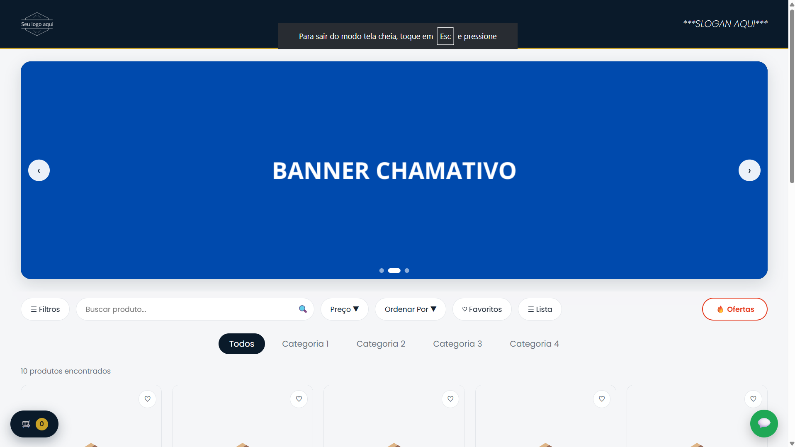
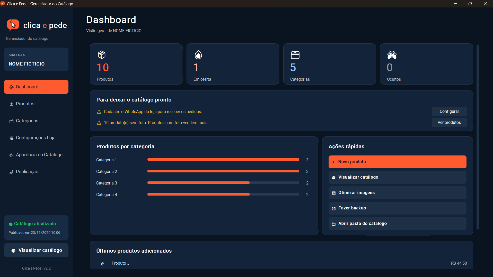
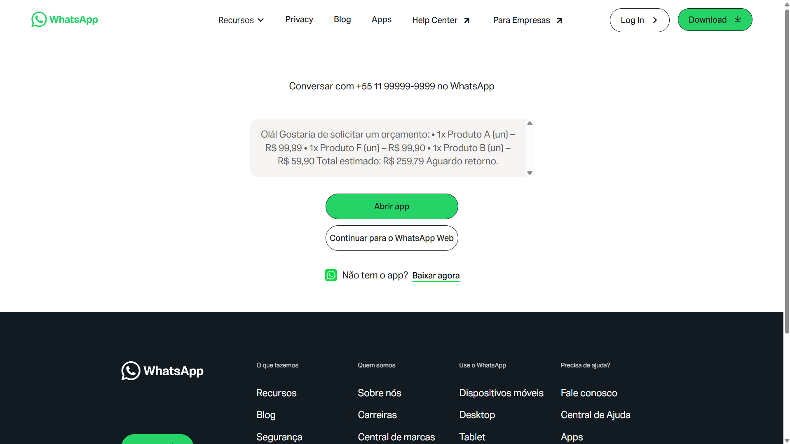
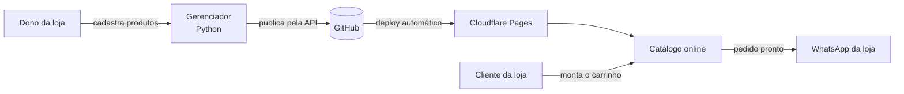

  

<h1 align="center">Clica &amp; Pede</h1>

  Catálogo online para pequenas lojas: o cliente monta o pedido e a loja recebe pronto no WhatsApp.

  
  
  
  
  

  <a href="https://catalogopadrao.netlify.app"><strong>Ver catálogo de demonstração</strong></a>

---

## O problema

Muita loja pequena vende pelo WhatsApp: o cliente pede foto de cada produto, pergunta o preço um por um, e no fim o pedido é anotado à mão, às vezes errado.

## A solução

O Clica &amp; Pede tem duas partes:

- **Catálogo online:** um site com os produtos da loja, fotos e preços. O cliente escolhe o que quer, monta o carrinho e envia o pedido pronto para o WhatsApp da loja.
- **Gerenciador:** um programa para Windows onde o próprio dono da loja cadastra e atualiza produtos, preços e fotos, e publica as mudanças com um clique, sem precisar entender de site.

## Telas

<!-- Coloque os prints na pasta "prints" com estes nomes -->
| Catálogo | Gerenciador | Pedido no WhatsApp |
|:---:|:---:|:---:|
|  |  |  |

## Como funciona

## Funcionalidades

### Catálogo
- Busca, categorias e filtros por tipo de produto
- Ordenação e filtro por faixa de preço
- Ofertas e lista de favoritos
- Visualização em grade ou em lista, com paginação
- Venda por unidade ou por pacote
- Carrinho com quantidade, salvo no navegador
- Pedido enviado já formatado para o WhatsApp da loja
- Página de cada produto com galeria de fotos
- Carrossel de banners e cores da marca de cada loja

### Gerenciador
- Cadastro de produtos, categorias e imagens
- Personalização da loja: nome, WhatsApp, cores, logo e banners
- Pré-visualização do catálogo no próprio computador antes de publicar
- Publicação com um clique, sem precisar ter o Git instalado
- Aviso de quando há mudanças ainda não publicadas
- Backup automático

## Decisões técnicas

- **Site estático:** carrega rápido e não precisa de servidor nem banco de dados para manter.
- **Publicação pela API do GitHub:** o gerenciador compara os arquivos locais com os do repositório e envia só o que mudou, num único commit.
- **Uma loja, um repositório:** cada loja tem o próprio repositório e um token de acesso só a ele, guardado apenas no computador do lojista.
- **Deploy automático:** a cada publicação, a Cloudflare Pages atualiza o site da loja.
- **Pensado para quem não é técnico:** o dono da loja nunca precisa saber o que é Git, deploy ou JSON.
## Trechos de código

- [`codigo/publicacao.py`](codigo/publicacao.py): publicação pela API do GitHub, enviando só os arquivos que mudaram
- [`codigo/carrinho.js`](codigo/carrinho.js): carrinho com quantidade e envio do pedido para o WhatsApp
## Tecnologias

| Parte | Tecnologias |
|---|---|
| Catálogo | HTML, CSS e JavaScript |
| Gerenciador | Python, CustomTkinter, Pillow e PyInstaller |
| Publicação | API do GitHub e Cloudflare Pages |

## Status

Em desenvolvimento e buscando os primeiros clientes.

> O código-fonte é privado, porque o Clica &amp; Pede é um produto comercial. Este repositório apresenta o projeto, as funcionalidades e as decisões técnicas.

## Contato

- Instagram: [@clicapede](https://www.instagram.com/clicapede)
- LinkedIn: [henryco-meneghetti](https://www.linkedin.com/in/henryco-meneghetti-1659b035b/)
